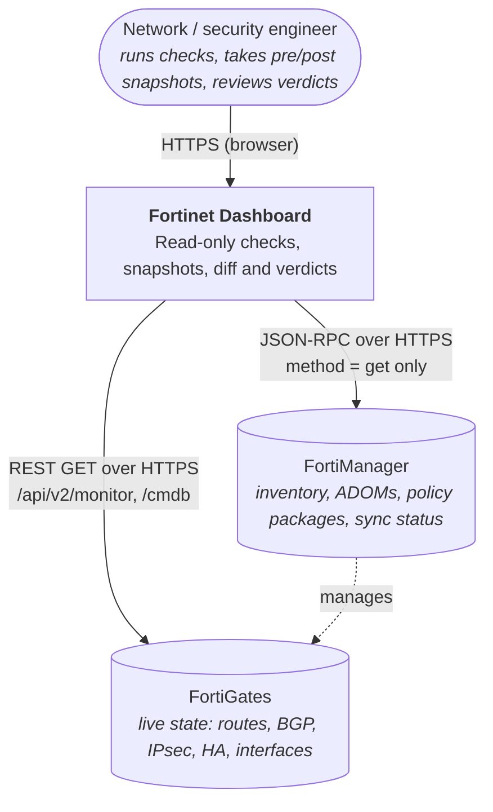
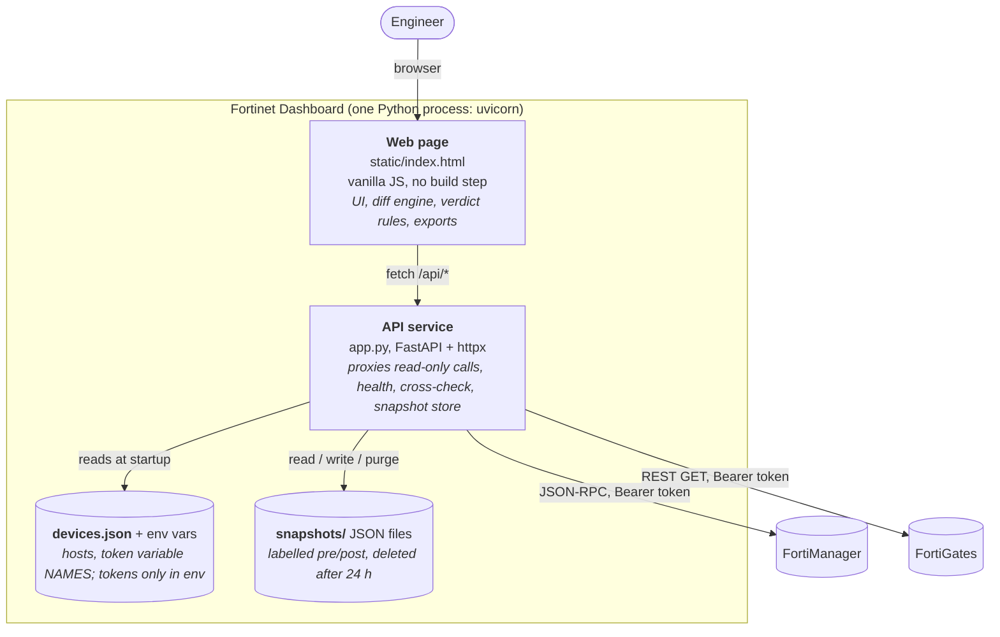
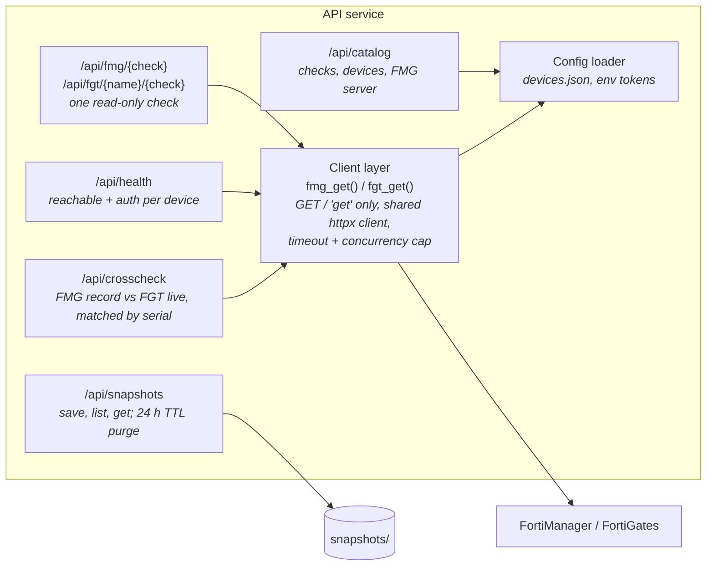
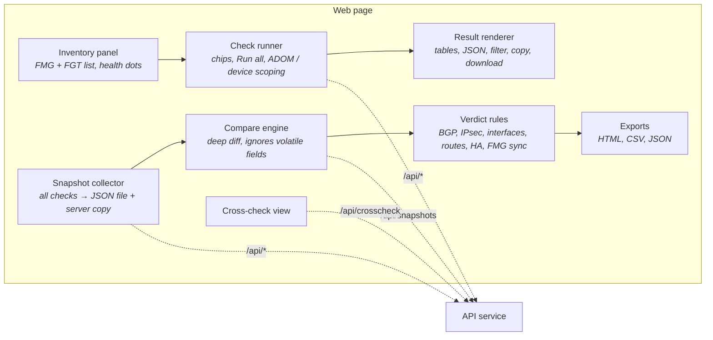

# Fortinet Dashboard: C4 architecture

Read-only web tool for checking FortiManager (FMG) and FortiGate (FGT) before and after changes.
Diagrams are Mermaid and render in GitHub, GitLab and the VS Code Markdown preview.

## Level 1: System context

## Level 2: Containers

Why the split: the browser never sees device tokens or talks to devices directly (TLS, CORS and
credentials stay on the server). The diff and verdict logic runs in the page so snapshots can also
be compared from uploaded files without a server round trip.

## Level 3: Components

### API service (app.py)

### Web page (static/index.html)

## Key design decisions

| Decision | Reason |
|---|---|
| Read-only by construction | FMG client hardcodes JSON-RPC method `get`; FGT client only issues `GET`. |
| API only, no SSH/CLI | Structured JSON diffs cleanly. CLI-only FMG diagnostics are listed in the UI as unavailable. |
| Tokens live in environment variables | `devices.json` stores only the variable name, so it is safe to share and back up. |
| Snapshots expire after 24 h | They contain full device state; `SNAPSHOT_TTL_HOURS` adjusts it. |
| Diff and verdicts in the browser | Works on uploaded files too; no server state needed to compare. |

## Runtime settings

| Variable | Default | Purpose |
|---|---|---|
| `VERIFY_TLS` | `true` | `false` for lab self-signed certificates |
| `CA_BUNDLE` | none | custom CA file |
| `HTTP_TIMEOUT` | `8` | seconds before an unreachable device fails |
| `MAX_PARALLEL` | `8` | concurrent requests to devices |
| `SNAPSHOT_TTL_HOURS` | `24` | snapshot retention |
| `FMG_TOKEN`, `FGT_*_TOKEN` | none | API tokens, named in `devices.json` |

## Not in scope today

Writes of any kind (config install, upgrades), user login for the dashboard, multiple FMGs,
FortiGate access through the FMG proxy, and a database. Each would add or change a container above.
