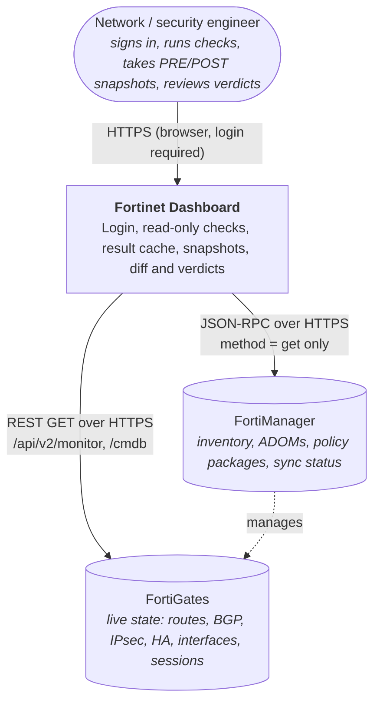
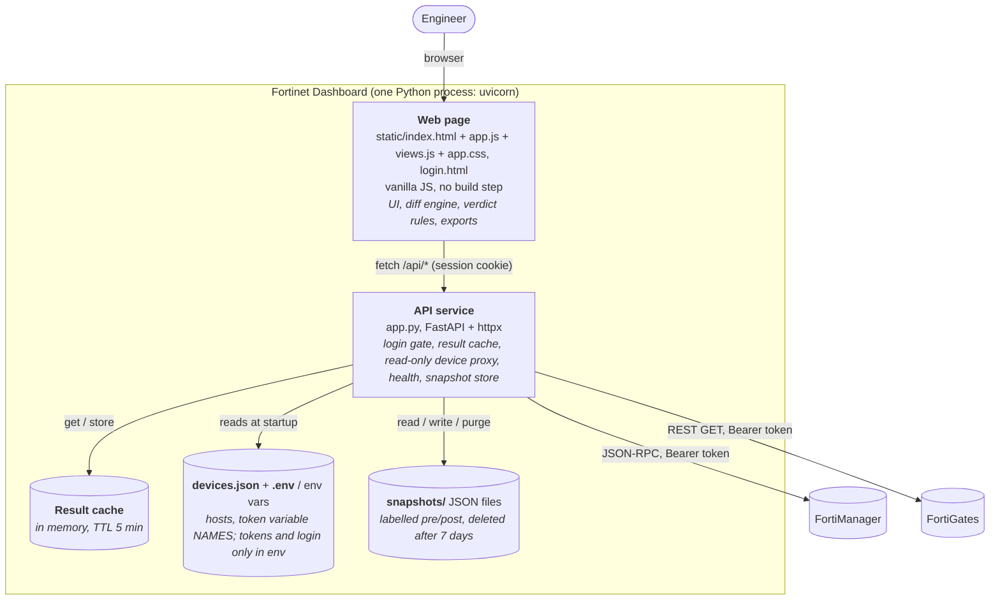
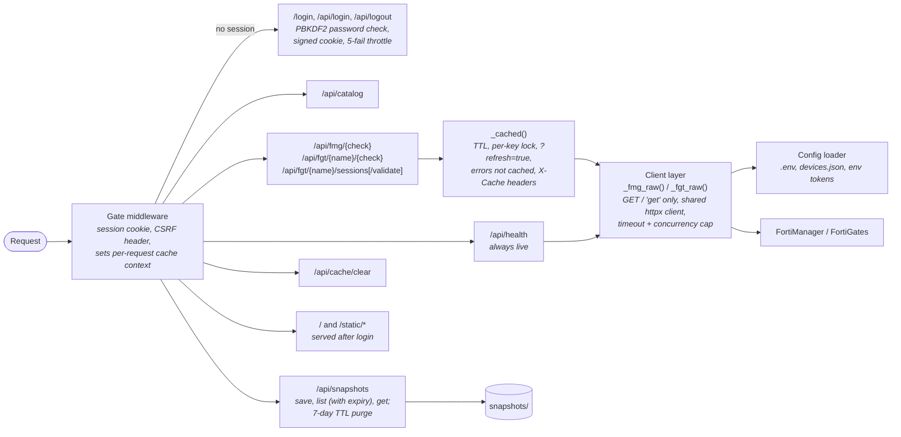
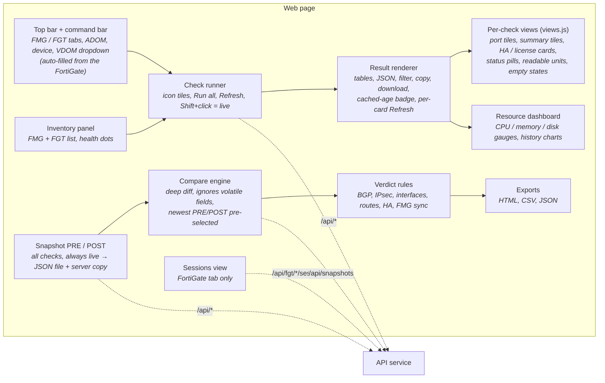

# Fortinet Dashboard: C4 architecture

Read-only web tool for checking FortiManager (FMG) and FortiGate (FGT) before and after changes.
Diagrams are Mermaid and render in GitHub, GitLab and the VS Code Markdown preview.

## Level 1: System context

## Level 2: Containers

Why the split: the browser never sees device tokens or talks to devices directly (TLS, CORS and
credentials stay on the server). The diff and verdict logic runs in the page so snapshots can also
be compared from uploaded files without a server round trip. The cache sits in the API service so
every browser action shares it and the devices are polled as little as possible.

## Level 3: Components

### API service (app.py)

### Web page (static/app.js + static/views.js)

## Key design decisions

| Decision | Reason |
|---|---|
| Read-only by construction | FMG client hardcodes JSON-RPC method `get`; FGT client only issues `GET`. |
| API only, no SSH/CLI | Structured JSON diffs cleanly. CLI-only FMG diagnostics are listed in the UI as unavailable. |
| Tokens live in environment variables | `devices.json` stores only the variable name, so it is safe to share and back up. `.env` is git-ignored. |
| Single shared login, standard library only | Enough to keep the page private on a lab network with no extra dependency or user database. PBKDF2 hash, HMAC-signed `HttpOnly` / `SameSite=Strict` cookie, `X-Requested-With` header on POSTs, per-IP throttle. Per-user accounts are out of scope. |
| Server-side result cache (default 5 min) | Clicking around must not poll the devices every time. Refresh is explicit (card, Refresh all, Shift+click, `?refresh=true`). Errors are never cached. |
| Health and snapshots always live | Health dots must show real reachability, and PRE/POST evidence must be real device state, not cached data. |
| Snapshots expire after 7 days | They contain full device state; `SNAPSHOT_TTL_HOURS` adjusts it. |
| Diff and verdicts in the browser | Works on uploaded files too; no server state needed to compare. |
| No build step for the front end | Plain HTML, CSS and JS served as static files. Per-check views live in `views.js`, chosen by check name, and fall back to the generic table for unknown checks. pytest runs `node --check` on both scripts and a render smoke test over sample data. |

## Runtime settings

Read from the process environment, or from a `.env` file next to `app.py` (real environment variables win).

| Variable | Default | Purpose |
|---|---|---|
| `DASH_PASSWORD_HASH` / `DASH_PASSWORD` | none (required) | dashboard login password (hash from `python app.py hash <pw>`; plain only for labs) |
| `DASH_USER` | `admin` | dashboard login name |
| `SESSION_SECRET` | random per start | signs login cookies; set it to keep logins across restarts |
| `SESSION_HOURS` | `8` | login lifetime |
| `CACHE_TTL_SECONDS` | `300` | result cache lifetime |
| `VERIFY_TLS` | `true` | `false` for lab self-signed certificates |
| `CA_BUNDLE` | none | custom CA file |
| `HTTP_TIMEOUT` | `8` | seconds before an unreachable device fails |
| `MAX_PARALLEL` | `8` | concurrent requests to devices |
| `SNAPSHOT_TTL_HOURS` | `168` | snapshot retention |
| `FMG_TOKEN`, `FGT_*_TOKEN` | none | API tokens, named in `devices.json` |

## Testing

`python -m pytest -q` runs the suite in `tests/` (login gate and lockout, cache hit/miss/refresh, errors not cached,
snapshot round trip and safe ids, `.env` loader, JavaScript syntax, per-check view rendering). Device calls are replaced by fakes, so no
FortiManager or FortiGate is needed.

## Not in scope today

Writes of any kind (config install, upgrades), multiple FMGs, per-user accounts or roles,
FortiGate access through the FMG proxy, and a database. Each would add or change a container above.
